<div align="center">

# Free My Android TV

**Free My Android, as an app on the television.**

Cleaning up a phone, a tablet or a TV is the other half: **[Free My Android](https://github.com/manishb27/freemyandroid)** · [freemyandroid.com](https://freemyandroid.com)

Five small apps, three looks to choose from, and a page that shows which preinstalled apps on the set are switched off.
One more app in the TV's apps row: the set's own home screen stays as it is.

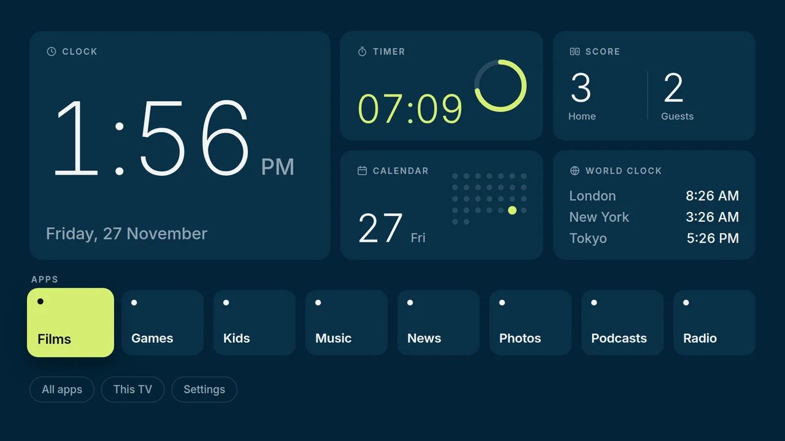

</div>

> **Being built.** The app is installed on one television (a OnePlus Y Series, Android 11) and has not been checked
> on its screen yet. The pictures here were taken in a browser, with sample app names; on a television the row holds
> that set's own apps.

## Three looks

| Quiet | Board | List |
|---|---|---|
| 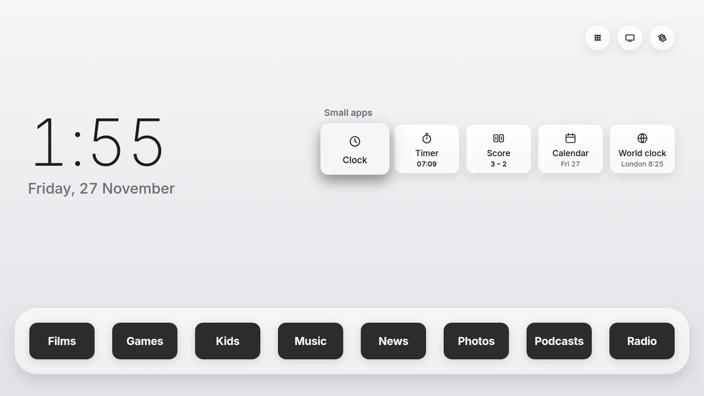 | 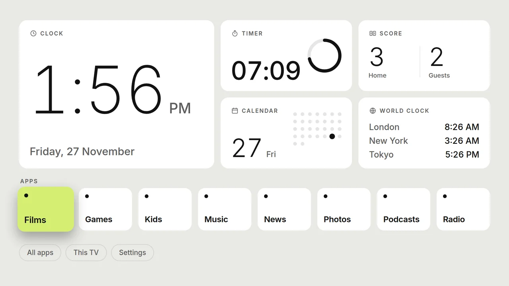 | 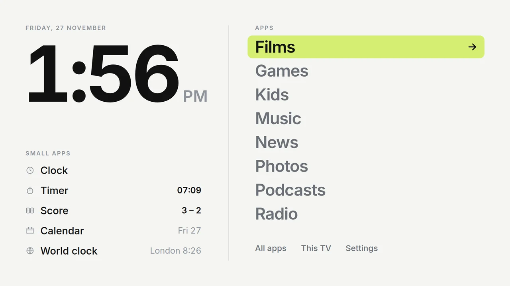 |
| 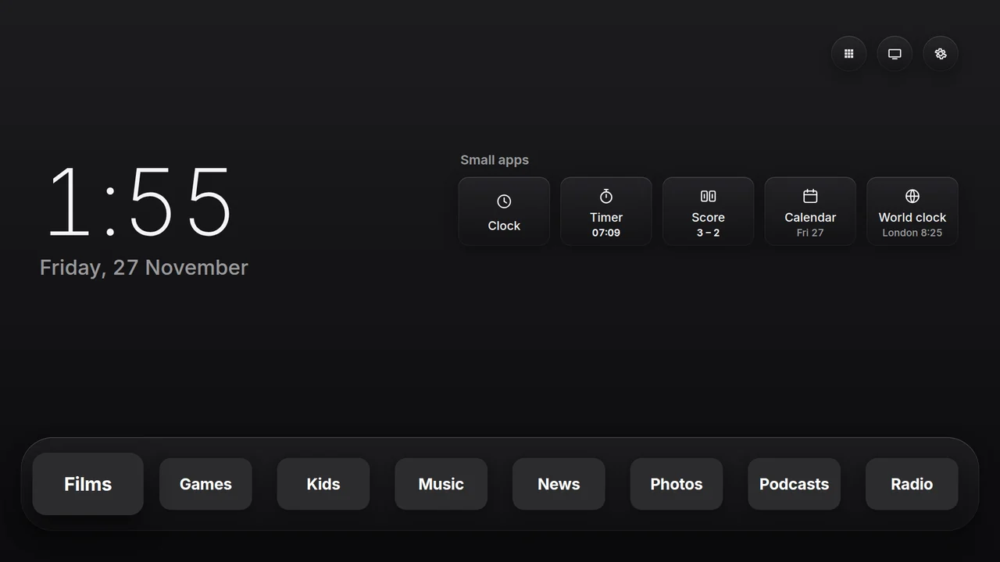 |  | 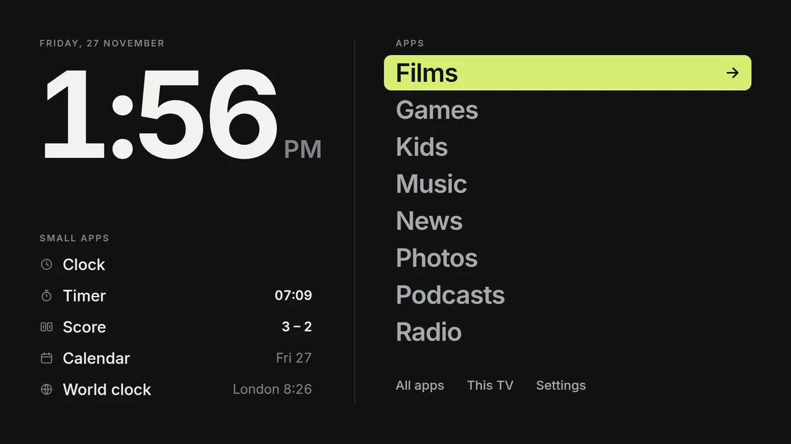 |
| The clock, a row of small apps, your apps along the bottom. | Each small app is a tile that shows what it is doing. | Words only, large enough to read from the sofa. |

Each look has a day and a night version, chosen by the clock or by hand.

## Five small apps

Each one fills the screen, works with the remote's arrows, OK and Back, needs no network, and remembers where it was.

| | |
|---|---|
| 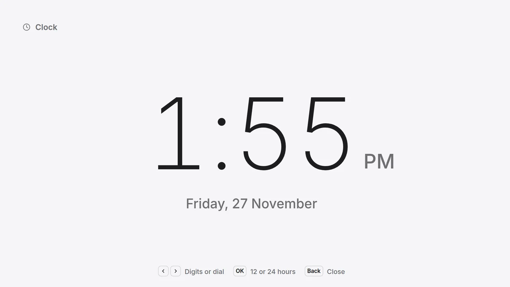 **Clock.** Digits or a dial, 12 or 24 hours. It drifts a few pixels so nothing burns in. | 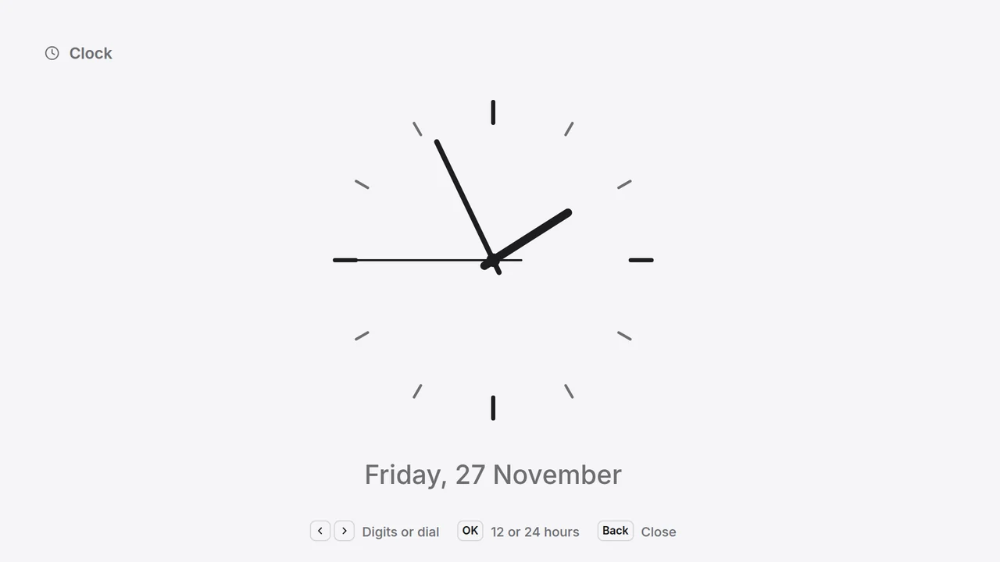 |
| 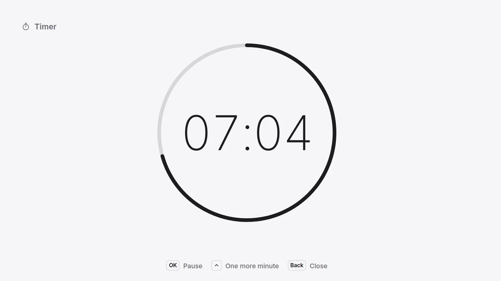 **Timer.** Minutes with left and right, OK to start and pause, up for one more minute. Its time left shows on the home. | 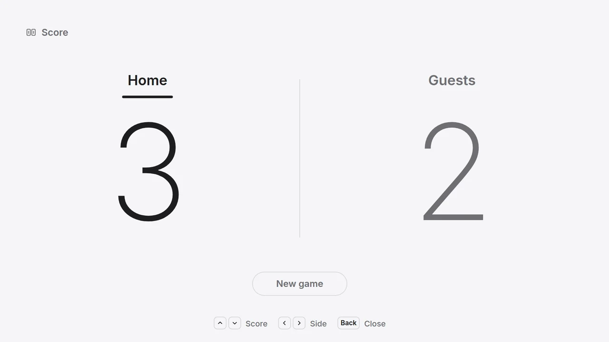 **Score.** Two sides, up and down to score, and a new game. |
| 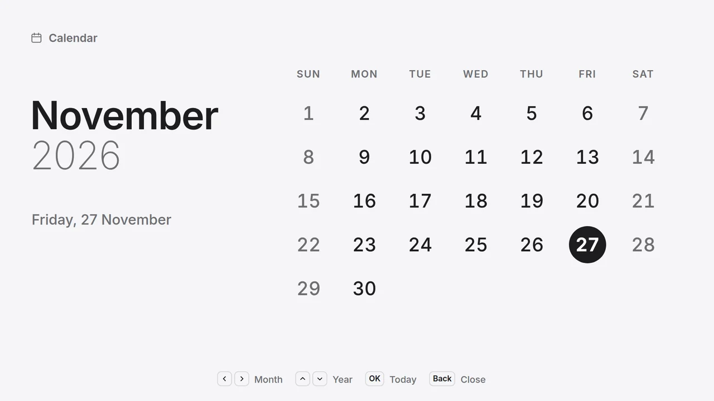 **Calendar.** A month at a time, today marked. | 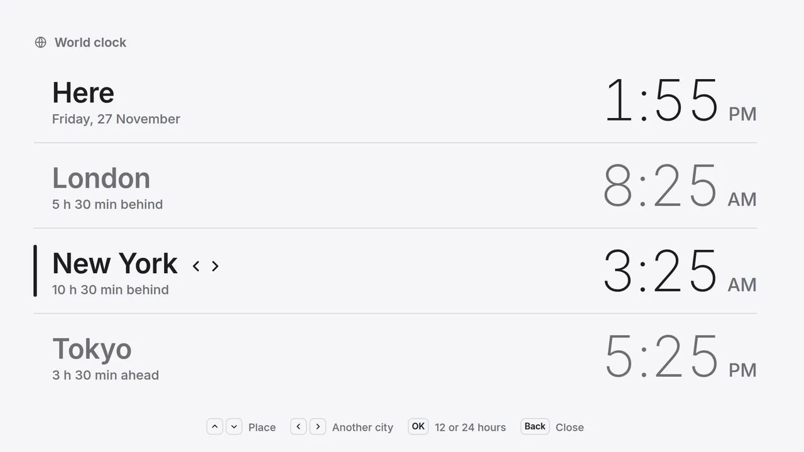 **World clock.** Here and three places, picked with the arrows. |

## And three pages

| | |
|---|---|
| 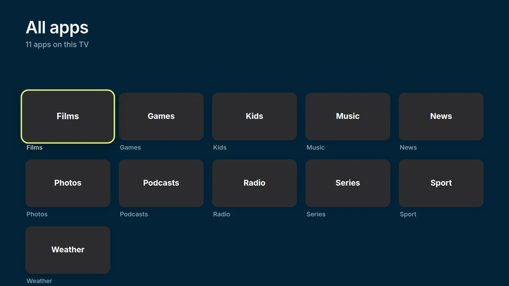 **All apps.** Every app on the TV, opened from here. | 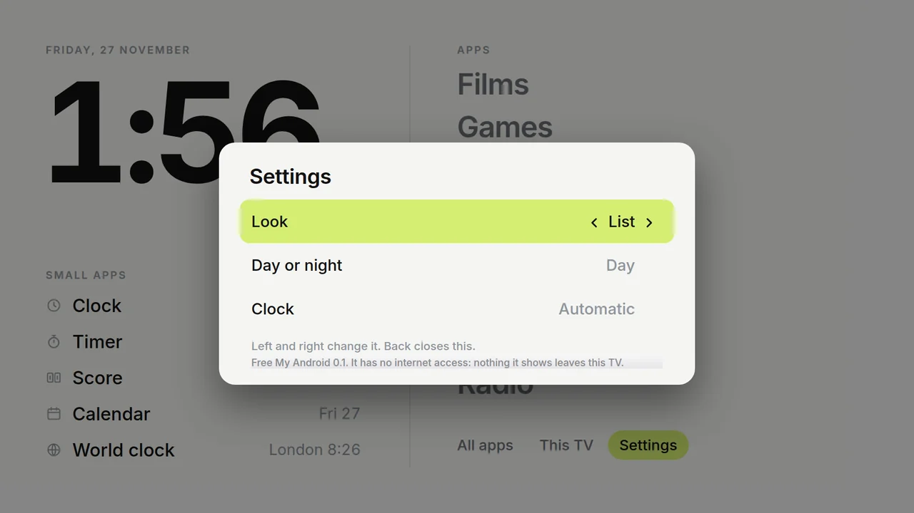 **Settings.** Look, day or night, 12 or 24 hours. |

**This TV** lists which of the 38 apps on [Free My Android](https://github.com/manishb27/freemyandroid)'s television
list are on the set, and whether each one is on or switched off. It only reads: switching apps off is done from a
computer with Free My Android, where every change is written down with its undo.

The app asks for no internet access. Nothing it shows leaves the television.

## Install

**The easy way:** paste this into Claude Code or Codex (or another AI agent that can run commands), which goes one step at a time:

```text
Install Free My Android TV on my Android TV from this computer, then open Free My Android in my browser. Tell me before each step.

1. Check that adb, git and python3 are installed. Install whatever is missing.
2. Ask me for the TV's IP address, then run: adb connect <IP>:5555 (I will press Allow on the TV).
3. curl -LO https://github.com/manishb27/freemyandroid-tv/releases/latest/download/FreeMyAndroid-TV.apk
4. adb install -r FreeMyAndroid-TV.apk
5. adb shell am start -n com.freemyandroid.tv/.MainActivity
6. git clone https://github.com/manishb27/freemyandroid ~/freemyandroid (or git -C ~/freemyandroid pull), then: cd ~/freemyandroid && ./freemyandroid web

Change nothing else on the TV.
```

**By hand.** Download `FreeMyAndroid-TV.apk` from the [latest release](https://github.com/manishb27/freemyandroid-tv/releases).
On the TV, switch on developer options and network debugging (where they are differs from one set to the next). Then,
from a computer with `adb`, on the same network as the TV:

From a computer with `adb`, on the same network as the TV, with network debugging on:

```sh
adb connect <TV address>:5555
adb install -r FreeMyAndroid-TV.apk
```

The TV may ask whether to allow debugging from this computer: say yes. The app then appears in the TV's apps row as
**Free My Android**.

## Build

```sh
android/build.sh
```

No Gradle. It needs JDK 17 and the Android SDK's build-tools 34 and android-34, and signs with a key it makes once
(`android/fma-tv.keystore`; keep it, updates need the same key).

## Look at it without a television

```sh
python3 tools/serve.py          # http://localhost:4412/
python3 tools/serve.py --lan    # also from a phone on the same Wi-Fi, with a remote drawn under the picture
```

Stand-in apps take the place of the TV's own. 1, 2 and 3 switch the look, N switches day and night, and the arrows,
Enter and Esc are the remote.

## What is where

| | |
|---|---|
| `web/` | The app's pages: `app.js` (the looks, the pages, the focus), `mini.js` (the five small apps), `app.css`, `tvlist.js` (the television list), Inter in `fonts/` |
| `android/` | The Android app around them: one activity with a WebView, and a bridge that lists and opens the TV's apps and reads which are switched off. `build.sh` builds it |
| `tools/` | `serve.py` (the browser preview) and `tvlist.py` (writes `web/tvlist.js` from Free My Android's television list) |
| `docs/screens/` | The pictures in this README |

## Phones and tablets

The tool that cleans up a phone, a tablet or a television over ADB is **[Free My Android](https://github.com/manishb27/freemyandroid)**,
in its own repository. This one is only the app that runs on the television. The website,
[freemyandroid.com](https://freemyandroid.com), has both.

## Who

Manish Babbar, Vaibhav Gupta, Pouya and Kartikaye Madhok.

## Licence

MIT: [LICENSE](LICENSE). The Inter typeface is under the SIL Open Font License ([web/fonts/OFL.txt](web/fonts/OFL.txt)).
Other notices: [NOTICE](NOTICE).
